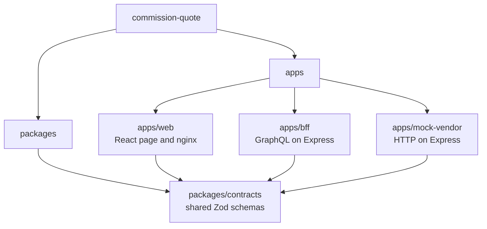
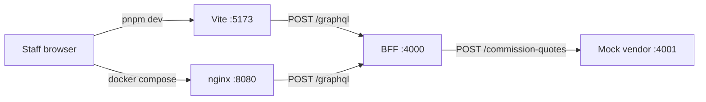

# Commission Quote

Staff enter loan details and see a commission quote. The real vendor does not exist yet. This repo runs a React page, a BFF, and a mock vendor so the form, the key boundary, and the failure states can be tried locally.

The page calls the BFF with one GraphQL mutation. GraphQL is our choice. The challenge does not require it. The vendor stays plain HTTP.

## Structure

The pnpm workspace has three apps and one shared contract. The web app, the BFF, and the mock vendor all import that contract.



A quote stays on this path. The browser reaches the BFF only. The BFF calls the mock vendor and adds the `api-key`. With `pnpm dev`, Vite proxies `/graphql`. In Compose, nginx does.



## Install

Use Node.js 22 or newer and pnpm 10 (`packageManager` in the root `package.json`).

```bash
pnpm install
```

## Environment

`pnpm dev` reads `.env.local`. That file is already in the repo. It holds a demo placeholder key, not a real vendor key. Do not replace it with a real key and commit that.

`docker-compose.yml` injects `.env.dev` into the mock vendor and the BFF when those containers start. That file uses the Compose hostnames (`http://mock-vendor:4001`). It is not copied into any image, and the nginx container does not receive it. Local `pnpm dev` does not read `.env.dev`.

| Name | Role |
| --- | --- |
| `VENDOR_API_URL` | Vendor origin. `.env.local` uses `http://localhost:4001`. `.env.dev` uses `http://mock-vendor:4001`. The BFF reads this. The browser never does. |
| `VENDOR_API_KEY` | Sent by the BFF as the `api-key` header. Server env only. |
| `VENDOR_TIMEOUT_MS` | How long the BFF waits for the vendor. `2000` if unset. |
| `VENDOR_FAILURE_RATE` | Chance the mock fails a quote, from `0` to `1`. `0.2` if unset (about one call in five). |
| `BFF_URL` | Where the Vite dev server proxies `/graphql`. `http://localhost:4000` if unset. nginx does not use this. It proxies to the BFF container directly. |

`ENABLE_COMMISSION_QUOTE=false` turns quotes off in the BFF before the vendor is called. The page then says `Commission quotes are turned off.` Any other value, or leaving it unset, leaves quotes on. Set it back to `true` and restart the BFF to turn them on again.

The page calls `/graphql` on its own origin. With `pnpm dev`, Vite proxies that to the BFF. In Compose, nginx does. The page has no vendor URL and no `api-key`.

## Start

```bash
pnpm dev
```

- Web: http://localhost:5173
- BFF GraphQL: http://localhost:4000/graphql
- Mock vendor health: http://localhost:4001/health

If port 5173 is already taken, Vite prints the next port. Open that URL.

On the page, enter a loan amount, a whole number of months, and a risk band (`LOW`, `MEDIUM`, or `HIGH`). Press **Generate Quote**. The button stays disabled until the quote or a short error replaces the loading text.

Example: amount `10000`, term `12`, band `LOW` returns commission rate `0.005` and total commission `50.00`. The quote id is new each time.

## Docker

Compose runs three containers together: the mock vendor (Node), the BFF (Node), and nginx. nginx serves the built staff page and proxies `/graphql` to the BFF. The vendor and the BFF stay on the Compose network. Only nginx is published.

```bash
docker compose up --build
```

Open http://localhost:8080. The same form is there. `pnpm dev`, `pnpm test`, `pnpm lint`, and `pnpm typecheck` are unchanged.

The vendor key is read from `.env.dev` at start. It is not a Docker build arg. nginx runs as an unprivileged user, with a read-only root filesystem and no extra capabilities. It adds the usual staff-page headers (including a content security policy and `X-Frame-Options: DENY`), caps the quote body at 16 KB, and limits how fast `/graphql` can be called. It also clears any `api-key` or `x-simulate` header on the way to the BFF, so the browser cannot pass the vendor key or force a fault. TLS for a real deployment would stop in front of nginx. This demo speaks HTTP on the Compose network and does not send HSTS.

## Test

```bash
pnpm test
pnpm lint
pnpm typecheck
```

## Mock formula and demo limits

The challenge does not define a commission formula or a maximum loan. The numbers below are demo assumptions. When a real vendor arrives, delete the formula and trust the vendor's quote.

Commission rate by risk band: `LOW` is `0.005`, `MEDIUM` is `0.0075`, `HIGH` is `0.01`. Total commission is the loan amount times that rate, rounded half up to 2 decimals. The term is checked and does not change the rate. This demo assumes a higher band means a higher rate. A real vendor may use one rate for every band.

Until a real contract says otherwise, the app assumes one currency, a maximum loan amount of `10000000`, and a maximum term of `360` months. `360` is a 30-year demo cap, not a vendor rule. The commission rate is at most `1`, and the total commission cannot exceed `10000000`.

The same loan details can return a new `quoteId`. Do not retry a vendor call until the vendor agrees a repeat is safe.

## Force a vendor error

With `VENDOR_FAILURE_RATE=0.2`, some quotes fail on their own. The page then says `Quote unavailable. Try again.`

To force that error every time, set `VENDOR_FAILURE_RATE=1` in `.env.local` and restart `pnpm dev`. For Compose, set it in `.env.dev` and recreate the mock-vendor container. Generate a quote. Set the rate back to `0.2` afterwards. `0` makes the mock succeed on every call, which is useful when a random failure would hide a different bug.

`VENDOR_SIMULATION=forced` is for the Jest tests. In that mode the mock honors an `x-simulate` header of `success`, `error`, or `timeout` from the BFF. The browser never sends that header, and `pnpm dev` does not turn the env var into one. Leave `VENDOR_SIMULATION` out of `.env.local`.

## Later

- Staff login and a role check, so only lending staff can generate quotes.
- An audit log of who asked, when, and which `quoteId` came back.
- The real vendor behind the same BFF client. Keep the mock for local dev and tests.
- Retries, only after the vendor says a repeat call is safe. Until then the mock can mint a new `quoteId` for the same loan.

## AI

I drove the architecture: a React page, a BFF, and a mock vendor, with the vendor key staying on the server. I also added Cursor rules for that plan: keep the vendor key on the server, time out the vendor call and disable Generate Quote while a request is in flight, share one TypeScript contract, keep GraphQL as the only door from the browser, keep the mock vendor on plain HTTP, run Node 22 without logging secrets, test the paths that can lose money or leak the key, and give the form visible labels and announced errors. Cursor's AI then built the app step by step from that plan and those rules (vibe coding). Then I reviewed and polished the result, and checked the form by hand: amount `10000` at `LOW` returned rate `0.005` and total `50.00`, amount `0` stayed on the page, and a forced vendor failure showed `Quote unavailable. Try again.` The page did not show the key or the vendor URL.